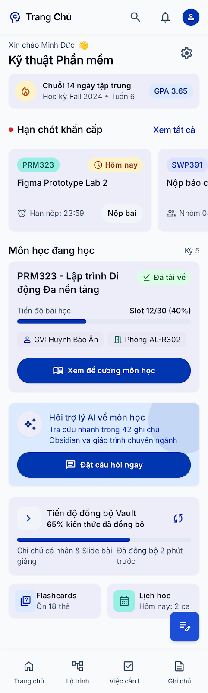
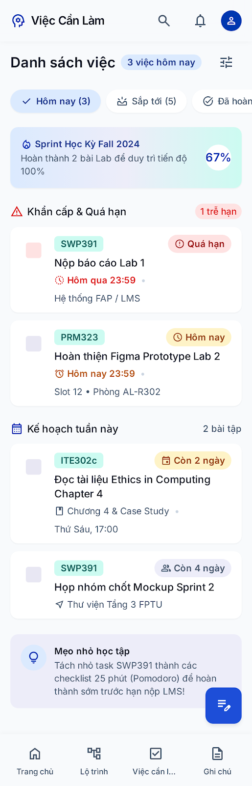

# AI DESIGN LOG: QUÁ TRÌNH TẠO VÀ TINH CHỈNH UI VỚI AI

Tài liệu này ghi lại toàn bộ quá trình làm việc với công cụ tạo giao diện bằng AI (Google Stitch) và trợ lý AI phản biện theo đúng quy trình bắt buộc tại Mục 4 và Mục 5 của đề bài Lab 2.

- **Dự án:** FPTU Second Brain Mobile (Companion App cho sinh viên SE Đại học FPT)
- **Persona:** Nguyễn Minh Đức (20 tuổi, SV SE, thao tác một tay trên xe bus, mạng chập chờn)
- **Công cụ AI sử dụng:**
  - **Google Stitch:** Tạo UI ban đầu và thực hiện các vòng lặp tinh chỉnh giao diện.
  - **Gemini:** Trợ lý AI phản biện UX độc lập theo 10 Usability Heuristics (Nielsen), tiêu chuẩn Accessibility (WCAG 2.1 AA) và Persona.

---

## 1. Thiết lập Ngữ cảnh & Khởi tạo Design System trong Google Stitch

Thay vì để Stitch tự do chọn phong cách ngẫu nhiên (dễ bị lệch sang nền tối Cyberpunk của bản desktop), dự án sử dụng tính năng nạp trực tiếp tài liệu quy chuẩn **`design/DESIGN.md`** vào Stitch để trích xuất và cố định hệ thống Design System ngay từ đầu.

### 1.1. Phương thức Thiết lập
1. **Nạp Design Spec:** Chọn `Start with your design` trong Stitch và nhập toàn bộ nội dung từ file `design/DESIGN.md`.
2. **Trích xuất Design System:** Stitch tự động phân tích và tạo bộ quy chuẩn `FPTU Second Brain Mobile Design System` gồm:
   - **Bảng màu:** Cố định `Primary Blue` (`#1D4ED8`), `Secondary Teal` (`#0F766E`), nền sáng `Surface` (`#F8FAFC`).
   - **Typography:** Khóa font chữ `Inter` hỗ trợ đầy đủ tiếng Việt có dấu.
   - **Component Styles:** Nút bấm bo tròn `radius-full`, Card bo góc `radius-md`, thanh tìm kiếm và App Bar theo chuẩn Material Design 3.

### 1.2. Bằng chứng Trích xuất Design System từ Stitch


*(Ảnh chụp màn hình bảng Design System do Google Stitch tự động trích xuất thành công từ file `design/DESIGN.md`)*

---

## 2. Tạo UI Ban Đầu (Initial UI Generation)

### 2.1. Prompt Nguyên văn gửi Google Stitch
Prompt tạo 2 màn hình bao phủ flow chính (SCR-01 Trang chủ thuộc Flow 1 và SCR-04 Việc cần làm & Snackbar Hoàn tác thuộc Flow 2):

```text
Design an Android mobile app named "FPTU Second Brain Mobile" for software engineering university students.

Core Design Rules (Material Design 3):
- Viewport: 360 x 800 dp frame.
- Theme: Clean LIGHT THEME only (Background #F8FAFC, Card Surface #FFFFFF, Primary Blue #1D4ED8, Secondary Teal #0F766E, Warning Container #FEF3C7, Error Container #FEE2E2). Absolutely NO dark mode, NO cyberpunk neon.
- Typography: Inter font, all content text must be strictly >= 14 sp. High line-height.
- Touch Ergonomics: Interactive targets (buttons, checkboxes, chips, tab icons) must be at least 48 x 48 dp.

Screen 1: SCR-01 Trang chủ (Dashboard)
- Top App Bar (56 dp): Title "Kỹ thuật Phần mềm", right icon Settings linking to SCR-08.
- Section 1 (Urgent Deadlines Carousel): Horizontal cards for tasks due <= 3 days. Each card shows subject code "PRM323", task name "Figma Prototype Lab 2", badge with schedule icon + text "Hôm nay" (Amber #FEF3C7, text #92400E). Text button "Xem tất cả" aligned right.
- Section 2 (Recent Course Card): Card showing "PRM323 - Lập trình Di động Đa nền tảng", slot progress "Slot 12/30", button "Xem đề cương".
- Section 3 (AI Banner): Light Blue #DBEAFE background, text "Hỏi trợ lý AI về môn học", icon auto_awesome, button "Đặt câu hỏi".
- Section 4: Linear progress bar (65% kiến thức đã đồng bộ).
- Bottom Navigation Bar (80 dp): 4 items (Trang chủ [Active], Lộ trình, Việc cần làm, Ghi chú).
- Floating Action Button (FAB): 56x56 dp at bottom right with edit icon.

Screen 2: SCR-04 Việc cần làm (Tasks & Deadline)
- Top App Bar: Title "Việc cần làm", filter chip row: "Hôm nay" [Selected], "Sắp tới", "Đã hoàn thành".
- Task List:
  * Item 1 (Overdue): Left checkbox (48x48 dp touch target). Center: "Nộp báo cáo Lab 1", course "SWP391", badge with error icon + text "Quá hạn" (Red #FEE2E2, text #991B1B).
  * Item 2 (Due Today): Checkbox 48x48 dp. Title "Hoàn thiện Figma Prototype Lab 2", course "PRM323", badge "Hôm nay" (Amber #FEF3C7, text #92400E).
- Floating Snackbar (SN-01) above bottom nav: Background #1E293B, text "Đã hoàn thành task", blue text button "HOÀN TÁC".
- Bottom Navigation Bar: Tab "Việc cần làm" [Selected].
```

### 2.2. Kết quả từ Google Stitch (Ảnh chụp bằng chứng)
- Giao diện ban đầu SCR-01 Trang chủ:
  

- Giao diện ban đầu SCR-04 Việc cần làm:
  
