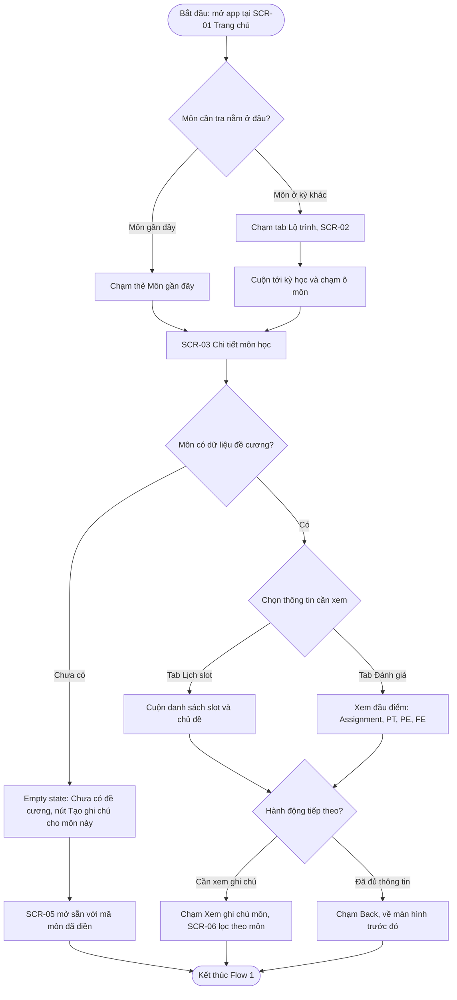
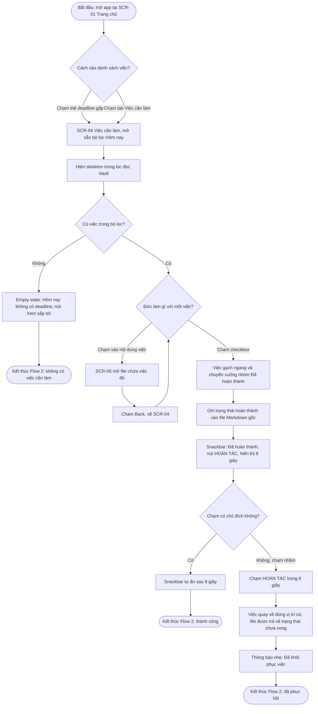
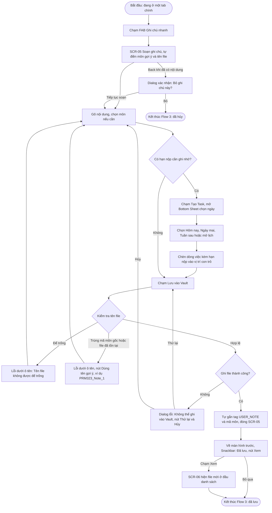
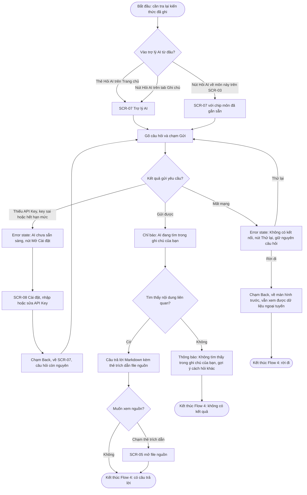

# UX ANALYSIS: INFORMATION ARCHITECTURE & USER FLOWS

> Tài liệu này bám theo `ux/persona.md`. Các mục tiêu của persona được ký hiệu **G1–G4**:
> G1 = Nắm cấu trúc và nội dung slot môn học · G2 = Tổng hợp công việc cần làm · G3 = Tra cứu ghi chú bài học · G4 = Ghi chép nhanh (Quick Capture).
> Các tiêu chí đo được **M1–M3** là ba tiêu chí trong mục 5 của persona (M1 = tra cứu ≤ 8 giây và ≤ 3 chạm, M2 = tạo deadline ≤ 15 giây, M3 = Undo trong Snackbar 8 giây).

---

## 0. Phạm vi và Giả định của bản Mobile

- **Vai trò của app:** ứng dụng đồng hành, **đọc và ghi trực tiếp** vào thư mục Obsidian Vault đã được đồng bộ sẵn giữa laptop và điện thoại (giả định trong persona).
- **Việc chạy trên desktop, không có trên mobile:** cào dữ liệu FLM (đăng nhập cổng trường), vector hóa kho tri thức, tạo ngành/kỳ/môn, Hard Reset AI. Vì vậy mobile **không có màn hình đăng nhập FLM**; đề cương xuất hiện trong Vault dưới dạng file đã đồng bộ (nhãn `FLM SYNC`).
- **Ngoại tuyến:** xem đề cương, xem và tick task, soạn ghi chú đều dùng được vì chỉ đọc/ghi file cục bộ. **Trợ lý AI cần mạng.**
- **Ngoài phạm vi (ghi nhận để tránh bị hỏi khó):** xử lý xung đột khi một file bị sửa đồng thời trên laptop và điện thoại (do dịch vụ đồng bộ đảm nhiệm); thông báo nhắc deadline ngoài app; dark theme; chèn liên kết `[[...]]`.
- **Số lượng:** 8 màn hình độc lập (không tính dialog, bottom sheet, snackbar và các biến thể trạng thái), 4 user flow.

---

## 1. Kiến trúc Thông tin (Information Architecture)

### 1.1. Danh sách 8 Màn hình

| Mã | Tên hiển thị trên UI | Cấp | Nội dung chính (theo thứ tự ưu tiên thị giác) | Trạng thái cần thiết kế |
| :--- | :--- | :---: | :--- | :--- |
| **SCR-01** | Trang chủ | L1 (Tab 1) | (1) Carousel **deadline gấp** (≤ 3 ngày hoặc quá hạn, tối đa 3 thẻ, nhãn chữ "Quá hạn" / "Hôm nay" / "Còn N ngày", nút "Xem tất cả" → SCR-04); (2) "Môn gần đây" mở nhanh SCR-03; (3) thẻ "Hỏi trợ lý AI" → SCR-07; (4) thanh tiến độ thu thập kiến thức (thông tin phụ). AppBar có tên ngành và icon Cài đặt → SCR-08. | populated, loading (skeleton), empty (chưa kết nối Vault), banner ngoại tuyến |
| **SCR-02** | Lộ trình | L1 (Tab 2) | Timeline dọc 9 học kỳ; mỗi ô môn có mã môn, tên môn và trạng thái dữ liệu. Trạng thái luôn có **icon + nhãn chữ**, không chỉ màu: "Chưa có tài liệu", "Đã tải về", "AI đã phân tích". | populated, loading, empty |
| **SCR-03** | Chi tiết môn học | L2 | Tab nội bộ: **Lịch slot** (mặc định) · **Đánh giá** (Assignment, Progress Test, PE, FE) · **Tổng quan** (chuẩn đầu ra, giáo trình). Hai nút hành động: "Xem ghi chú môn" → SCR-06 (lọc theo môn) và "Hỏi AI về môn này" → SCR-07 (gắn sẵn mã môn). | populated, empty (môn chưa có đề cương), banner ngoại tuyến |
| **SCR-04** | Việc cần làm | L1 (Tab 3) | Bộ lọc: Hôm nay · Sắp tới · Đã hoàn thành. Nhóm "Quá hạn" luôn nằm đầu danh sách. Mỗi dòng: checkbox (vùng chạm 48 × 48 dp, tách khỏi vùng chạm của dòng), tên việc, môn, hạn và nhãn chữ trạng thái. Chạm vào nội dung dòng mở file chứa việc đó. | populated, loading (skeleton), empty theo từng bộ lọc |
| **SCR-05** | Soạn ghi chú | L2 (toàn màn hình, modal) | Chế độ **Tạo mới / Sửa**. Ô tên file (tự gợi ý `<MãMôn>_Note_N`), chip chọn môn, vùng soạn Markdown. Thanh công cụ nằm sát bàn phím (vùng ngón cái): "Tạo Task" (mở bottom sheet chọn ngày) và "Lưu vào Vault". Tự gắn tag `#USER_NOTE` và `#<MãMôn>` khi lưu nếu chưa có. | mới, sửa, lỗi tên file, lưu thất bại |
| **SCR-06** | Ghi chú | L1 (Tab 4) | Ô tìm kiếm ghi chú và nút "Hỏi AI". Danh sách file có huy hiệu chữ **FLM SYNC** hoặc **USER NOTE**. Khi mở từ SCR-03 màn này tự lọc theo một môn (hiện chip môn). | populated, đang lọc theo môn, kết quả tìm rỗng, empty (chưa có ghi chú) |
| **SCR-07** | Trợ lý AI | L2 | Hội thoại hỏi đáp (RAG): ô nhập, bong bóng chat, câu trả lời Markdown kèm **thẻ trích dẫn file nguồn**. Chip ngữ cảnh môn khi mở từ SCR-03. | trống (gợi ý câu hỏi), đang tìm, có câu trả lời, không tìm thấy, lỗi mạng, lỗi cấu hình AI |
| **SCR-08** | Cài đặt & Đồng bộ Vault | L2 | Đường dẫn Vault và thời điểm quét gần nhất; nút "Quét lại Vault" (loading → "Đã cập nhật N file"); ô Gemini API Key (ẩn/hiện); thông tin phiên bản. **Không có** đăng nhập FLM. | mặc định, đang quét, quét xong, lỗi (không tìm thấy thư mục) |

### 1.2. Cấu trúc Điều hướng

Điều hướng chính dùng **Navigation Bar 4 điểm đến**. Nút **Ghi chú nhanh (FAB)** nằm góc dưới bên phải, ngay phía trên thanh điều hướng.

```text
App Root
├── [Navigation Bar - Cấp 1]  (nhãn hiển thị trên UI)
│   ├── Tab 1  Trang chủ       → SCR-01   (mặc định)
│   ├── Tab 2  Lộ trình        → SCR-02
│   ├── Tab 3  Việc cần làm    → SCR-04
│   ├── Tab 4  Ghi chú         → SCR-06
│   └── [FAB Ghi chú nhanh]    → SCR-05 (hiện trên 4 tab, ẩn ở màn cấp 2)
│
└── [Màn hình cấp 2 - push lên trên tab]
    ├── SCR-01 / SCR-02  ──► SCR-03 Chi tiết môn học
    │       ├── "Xem ghi chú môn"     ──► SCR-06 (lọc theo môn)
    │       ├── "Hỏi AI về môn này"   ──► SCR-07 (kèm mã môn)
    │       └── "Tạo ghi chú" (môn chưa có dữ liệu) ──► SCR-05
    ├── SCR-01 (thẻ Hỏi AI) / SCR-06 (nút Hỏi AI) ──► SCR-07 Trợ lý AI
    │       ├── Chạm thẻ trích dẫn           ──► SCR-05 (mở file nguồn)
    │       └── Lỗi cấu hình AI "Mở Cài đặt" ──► SCR-08
    ├── SCR-04 (chạm nội dung việc) / SCR-06 (chạm file) ──► SCR-05
    └── SCR-01 (icon Cài đặt trên AppBar) ──► SCR-08
```

### 1.3. Quy tắc nút Back (dùng cho prototype và handoff)

| Tình huống | Hành vi Back |
| :--- | :--- |
| Đang ở tab chính khác Trang chủ | Về Trang chủ |
| Đang ở Trang chủ | Thoát app |
| Màn cấp 2 (SCR-03, 07, 08) | Về đúng màn hình đã mở nó |
| SCR-05 chưa có nội dung | Đóng, về màn hình trước |
| SCR-05 đã có nội dung chưa lưu | Hiện dialog xác nhận **D-01 "Bỏ ghi chú này?"** |
| SCR-08 mở từ lỗi AI | Về SCR-07, **giữ nguyên câu hỏi đã gõ** |

### 1.4. Quyết định về IA (có lý do bám persona)

1. **Cài đặt không chiếm một tab.** Đây là màn ít dùng (đặt một lần), trong khi persona mở app 5–8 lần/ngày chỉ để xem việc và tra cứu. Cài đặt chuyển thành icon trên AppBar của Trang chủ.
2. **Ghi chú lên thành Tab 4.** Mục tiêu G3 ("tìm lại ghi chú mà không mở từng file") cần một điểm vào cấp cao nhất kèm tìm kiếm. Ghi chú nhanh không có môn (mã `QUICK` bên desktop) cũng có chỗ hiển thị.
3. **FAB đặt góc dưới bên phải thay vì giữa.** Nằm trong vùng ngón cái khi cầm một tay, và triển khai được bằng `Scaffold.floatingActionButton` cùng `NavigationBar` chuẩn (không cần widget tùy biến).
4. **Bỏ đăng nhập FLM khỏi mobile.** Phù hợp giả định của persona: Vault đã đồng bộ, app mobile chỉ đọc kết quả. Việc này loại bỏ luôn rủi ro hết phiên đăng nhập trên điện thoại.
5. **Trợ lý AI có 3 điểm vào** (Trang chủ, Ghi chú, Chi tiết môn), vì đây là tính năng nằm sâu ở cấp 2 và cần dễ tìm thấy.

---

## 2. Chi tiết 4 User Flow

Mỗi flow tương ứng một mục tiêu của persona (G1 → Flow 1, G2 → Flow 2, G4 → Flow 3, G3 → Flow 4).

---

### Flow 1: Tra cứu Slot & Đầu điểm của Môn học (Syllabus Lookup) — G1, M1

- **Điểm bắt đầu:** mở app tại SCR-01 Trang chủ.
- **Mục tiêu:** xem số slot, nội dung từng slot và các đầu điểm đánh giá của một môn học.
- **Điểm kết thúc:** nắm được thông tin và quay lại màn hình trước, hoặc sang ghi chú của môn.



- **Happy path (M1):** Trang chủ → chạm thẻ môn (1 chạm) → SCR-03 → chạm tab "Đánh giá" (2 chạm). Đạt ≤ 3 chạm.
- **Alternate A:** Trang chủ → tab Lộ trình (1) → ô môn (2) → tab "Đánh giá" (3). Vẫn ≤ 3 chạm.
- **Alternate B (môn chưa có dữ liệu):** SCR-03 hiện empty state với một hành động "Tạo ghi chú cho môn này" → SCR-05.
- **Alternate C (ngoại tuyến):** khi mất mạng, Trang chủ và SCR-03 hiện banner "Đang ngoại tuyến, dữ liệu cập nhật lần cuối dd/mm" nhưng nội dung đề cương vẫn đầy đủ. Đây là cách mô phỏng ngoại tuyến cho phép đo M1 trên prototype.

---

### Flow 2: Quản lý Deadline & Phục hồi khi Chạm nhầm (Task & Undo) — G2, M3
*(Flow có nhánh lỗi và phục hồi theo yêu cầu đề bài)*

- **Điểm bắt đầu:** mở app tại SCR-01 Trang chủ.
- **Mục tiêu:** xem việc cần làm trong ngày và đánh dấu hoàn thành.
- **Điểm kết thúc:** danh sách việc được cập nhật đúng, hoặc việc lỡ tick được khôi phục.



- **Happy path:** Trang chủ → chạm thẻ deadline gấp → SCR-04 → chạm checkbox → Snackbar tự ẩn sau 8 giây → thay đổi được giữ.
- **Alternate A:** vào bằng tab "Việc cần làm" thay vì thẻ trên Trang chủ.
- **Alternate B:** chạm nội dung một việc → SCR-05 mở đúng file chứa việc đó → Back về SCR-04.
- **Alternate C (empty):** bộ lọc không có việc → empty state kèm hành động "Xem sắp tới".
- **Error & Recovery (M3):** do rung lắc trên xe bus, Đức chạm nhầm checkbox → Snackbar neo đáy trong **8 giây** → chạm **HOÀN TÁC** (1 chạm) → việc quay về đúng vị trí, trạng thái chưa xong.
- **Quy tắc ghi file:** thay đổi được ghi vào file **ngay khi tick**; HOÀN TÁC ghi ngược lại. Cách này tránh mất dữ liệu nếu app bị tắt trong lúc Snackbar còn hiển thị.
- **Phòng ngừa chạm nhầm:** checkbox có vùng chạm 48 × 48 dp và cách vùng chạm của dòng tối thiểu 8 dp; chạm vào dòng **không** tick việc.

---

### Flow 3: Ghi chú Nhanh kèm Deadline (Quick Capture) — G4, M2

- **Điểm bắt đầu:** đang ở một trong 4 tab chính (SCR-01, 02, 04 hoặc 06).
- **Mục tiêu:** lưu nhanh một ghi chú, có thể kèm một việc có hạn nộp.
- **Điểm kết thúc:** file được lưu an toàn vào Vault (không ghi đè file gốc), hoặc người dùng chủ động hủy.



- **Happy path (M2):** FAB (1) → gõ tên việc → chạm "Tạo Task" và chọn "Ngày mai" (2) → "Lưu vào Vault" (3). Môn học được điền sẵn theo ngữ cảnh nên không tốn thao tác chọn.
- **Alternate:** lưu ghi chú không kèm việc; hoặc bấm Back giữa chừng và chọn "Bỏ" / "Tiếp tục soạn" ở dialog xác nhận **D-01**.
- **Nhánh lỗi & phục hồi:**
  - *Tên file không hợp lệ:* để trống, trùng mã môn gốc của trường (ví dụ `PRM323`, chống ghi đè đề cương FLM) hoặc trùng file đã có → lỗi hiển thị ngay dưới ô tên, kèm nút "Dùng tên gợi ý" (`PRM323_Note_1`). **Nội dung đã gõ không bị mất.**
  - *Ghi file thất bại:* dialog lỗi **D-02** với "Thử lại" và "Hủy"; nội dung vẫn được giữ trong trình soạn.
- **Ngoại tuyến:** toàn bộ flow dùng được khi mất mạng vì chỉ ghi file cục bộ.

---

### Flow 4: Hỏi Trợ lý AI về Ghi chú (AI Knowledge Retrieval) — G3

- **Điểm bắt đầu:** cần tra lại kiến thức đã ghi; vào SCR-07 từ Trang chủ, tab Ghi chú hoặc Chi tiết môn.
- **Mục tiêu:** nhận câu trả lời trích từ ghi chú của chính mình, có dẫn nguồn.
- **Điểm kết thúc:** có câu trả lời (và có thể mở file nguồn), hoặc rời đi sau khi gặp lỗi.



- **Happy path:** Trang chủ → thẻ "Hỏi trợ lý AI" → SCR-07 → gửi câu hỏi → chỉ báo đang tìm → câu trả lời có thẻ nguồn.
- **Alternate A:** vào từ SCR-03 bằng "Hỏi AI về môn này" (mã môn đã gắn sẵn, tránh phải gõ lại ngữ cảnh).
- **Alternate B:** chạm thẻ trích dẫn → mở file nguồn trong SCR-05.
- **Alternate C (không có nội dung liên quan):** AI báo không tìm thấy trong ghi chú của người dùng và gợi ý cách hỏi khác, **không tự bịa câu trả lời**.
- **Nhánh lỗi & phục hồi:**
  - *Mất mạng:* error state nêu rõ nguyên nhân, có nút "Thử lại", **không mất câu hỏi đã gõ**.
  - *API Key thiếu/sai hoặc hết hạn mức:* error state có nút "Mở Cài đặt" → SCR-08 → sửa key → Back về SCR-07 và thử lại.

---

## 3. Bảng Ánh xạ User Flow sang Màn hình

| Mã | Màn hình | Cấp | Flow 1 Tra cứu | Flow 2 Deadline & Undo | Flow 3 Ghi chú nhanh | Flow 4 Hỏi AI |
| :--- | :--- | :---: | :---: | :---: | :---: | :---: |
| **SCR-01** | Trang chủ | L1 | **X** (Start) | **X** (Start) | **X** (điểm xuất phát) | **X** (điểm vào) |
| **SCR-02** | Lộ trình | L1 | **X** | | **X** (điểm xuất phát) | |
| **SCR-03** | Chi tiết môn học | L2 | **X** (Goal) | | | **X** (điểm vào) |
| **SCR-04** | Việc cần làm | L1 | | **X** (Goal) | **X** (điểm xuất phát) | |
| **SCR-05** | Soạn ghi chú | L2 | **X** (nhánh môn trống) | **X** (nhánh mở file) | **X** (Goal) | **X** (xem nguồn) |
| **SCR-06** | Ghi chú | L1 | **X** (End) | | **X** (End, nhánh Xem) | **X** (điểm vào) |
| **SCR-07** | Trợ lý AI | L2 | | | | **X** (Goal) |
| **SCR-08** | Cài đặt & Đồng bộ Vault | L2 | | | | **X** (nhánh phục hồi) |

Cả 8 màn hình đều được ít nhất một flow sử dụng và đều truy cập được từ điều hướng ở mục 1.2.

### Truy vết từ Persona đến Flow

| Mục tiêu persona | Flow | Tiêu chí đo liên quan |
| :--- | :--- | :--- |
| G1 Nắm cấu trúc và slot môn | Flow 1 | M1 (≤ 8 giây, ≤ 3 chạm) |
| G2 Tổng hợp công việc | Flow 2 | M3 (Undo trong Snackbar 8 giây) |
| G3 Tra cứu ghi chú | Flow 4 | (xem mục 5 để biết gợi ý bổ sung) |
| G4 Ghi chép nhanh | Flow 3 | M2 (≤ 15 giây) |

---

## 4. Danh mục Overlay và Trạng thái (phục vụ Prototype và Handoff)

| Mã | Loại | Dùng ở | Ghi chú |
| :--- | :--- | :--- | :--- |
| **D-01** | Dialog xác nhận | Flow 3 | "Bỏ ghi chú này?" với hai nút "Tiếp tục soạn" và "Bỏ". **Overlay bắt buộc cho prototype.** |
| **D-02** | Dialog lỗi | Flow 3 | "Không thể ghi vào Vault" với "Thử lại" và "Hủy" |
| **BS-01** | Bottom sheet | Flow 3 | Chọn ngày: Hôm nay, Ngày mai, Tuần sau, mở lịch |
| **SN-01** | Snackbar có hành động | Flow 2 | "Đã hoàn thành" kèm HOÀN TÁC, **8 giây** |
| **SN-02** | Snackbar có hành động | Flow 3 | "Đã lưu" kèm "Xem" |
| **LD-01** | Loading → kết quả | Flow 2 | Skeleton ở SCR-04 rồi hiện danh sách việc |
| **LD-02** | Loading → kết quả | Flow 4 | "AI đang tìm trong ghi chú của bạn" rồi hiện câu trả lời |
| **LD-03** | Loading → kết quả | SCR-08 | "Quét lại Vault" rồi hiện "Đã cập nhật N file" |
| **EM-01…04** | Empty state | SCR-01 (chưa kết nối Vault), SCR-03 (môn chưa có đề cương), SCR-04 (không có việc), SCR-06 (chưa có ghi chú) | Mỗi cái có icon, thông báo và đúng một hành động |
| **ER-01…03** | Error state | ER-01 mất mạng và ER-02 AI chưa sẵn sàng (Flow 4, SCR-07); ER-03 không tìm thấy thư mục Vault (SCR-08). Lỗi tên file ở Flow 3 dùng biến thể Error của Text Field | Có nguyên nhân dễ hiểu và hành động thử lại hoặc sửa |

---

## 5. Ghi chú cho bước kiểm tra tiếp theo

- **Flow 4 chưa có tiêu chí đo riêng** trong persona. Có thể bổ sung một tiêu chí như "5/5 người thử hiểu nguyên nhân khi mất mạng lúc hỏi AI và biết cách tiếp tục" (đã nêu ở lần phản biện trước).
- **Số màn hình đang đúng bằng mức tối thiểu (8).** Khi dựng Figma cần đảm bảo mỗi màn hình có bố cục thật sự khác nhau; SCR-06 có hai chế độ (toàn bộ và lọc theo môn) chỉ được tính là một màn hình.
