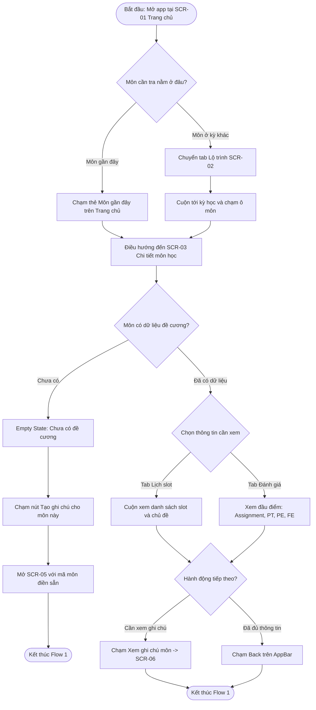
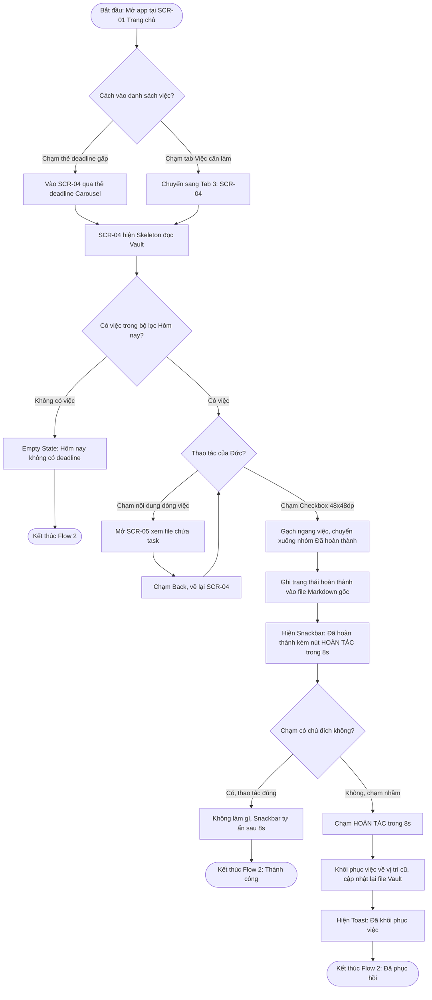
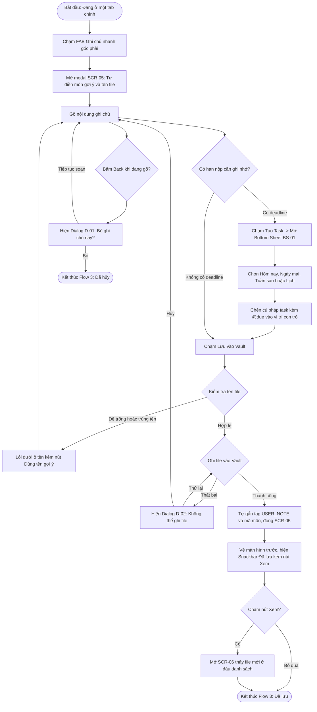
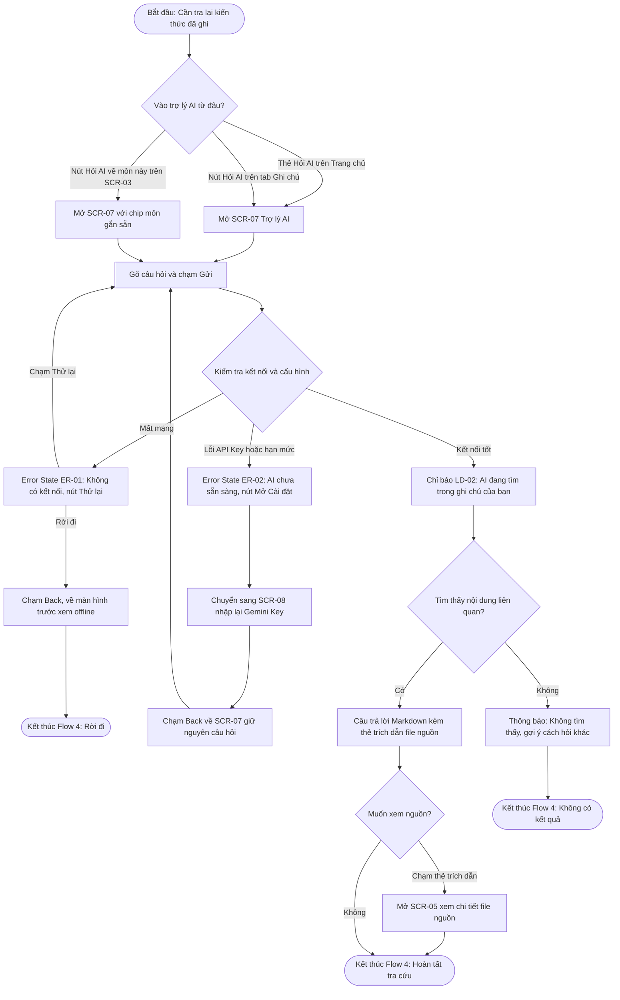

# UX ANALYSIS: INFORMATION ARCHITECTURE & USER FLOWS

Tài liệu này bám sát hồ sơ người dùng trong `ux/persona.md`. Các mục tiêu của persona được ký hiệu từ G1 đến G4:
- **G1:** Nắm cấu trúc và nội dung slot môn học.
- **G2:** Tổng hợp công việc cần làm.
- **G3:** Tra cứu ghi chú bài học.
- **G4:** Ghi chép nhanh (Quick Capture).

Các tiêu chí đo lường tương ứng được ký hiệu M1, M2, M3 (M1: tra cứu ≤ 8 giây và ≤ 3 chạm; M2: tạo deadline ≤ 15 giây; M3: hoàn tác trong Snackbar 8 giây).

---

## 0. Phạm vi & Giả định của Ứng dụng Mobile (Scope & Assumptions)
- **Vai trò của app:** Ứng dụng đồng hành (companion app), đọc và ghi trực tiếp vào thư mục Obsidian Vault đã được đồng bộ sẵn giữa laptop và điện thoại (giả định trong persona).
- **Phần việc xử lý trên desktop (ngoài phạm vi mobile):** Tự động cào dữ liệu FLM (đăng nhập cổng trường), vector hóa kho tri thức, tạo ngành/kỳ/môn, Hard Reset AI. Do đó mobile không có màn hình đăng nhập FLM; đề cương xuất hiện trong Vault dưới dạng file đã đồng bộ (gắn nhãn `FLM SYNC`).
- **Khả năng ngoại tuyến (Offline):** Xem đề cương, xem và tick task, soạn ghi chú đều hoạt động tốt không cần mạng vì chỉ thao tác trên file cục bộ. Riêng Trợ lý AI bắt buộc phải có kết nối mạng.
- **Giới hạn phạm vi (Out of Scope):** Xử lý xung đột khi một file bị sửa đồng thời trên cả hai thiết bị (dịch vụ đám mây tự xử lý); thông báo đẩy (push notification) ngoài hệ điều hành; Dark Theme; chèn liên kết 2 chiều `[[...]]`.
- **Quy mô bàn giao:** Đúng 8 màn hình độc lập (không tính dialog, bottom sheet, snackbar và các biến thể trạng thái), 4 user flow hoàn chỉnh.

---

## 1. Kiến trúc Thông tin (Information Architecture - IA)

### 1.1. Danh sách 8 Màn hình Độc lập (Core Screens)

| Mã màn hình | Tên hiển thị UI | Cấp bậc | Nội dung chính (theo thứ tự ưu tiên thị giác) | Trạng thái cần thiết kế |
| :--- | :--- | :---: | :--- | :--- |
| **SCR-01** | Trang chủ | L1 (Tab 1) | (1) Carousel deadline gấp (≤ 3 ngày hoặc quá hạn, tối đa 3 thẻ, nhãn chữ "Quá hạn" / "Hôm nay" / "Còn N ngày", nút "Xem tất cả" → SCR-04);<br>(2) "Môn gần đây" mở nhanh SCR-03;<br>(3) Thẻ "Hỏi trợ lý AI" → SCR-07;<br>(4) Thanh tiến độ tích lũy tri thức toàn khóa. AppBar có tên ngành và icon Cài đặt → SCR-08. | populated, loading (skeleton), empty (chưa kết nối Vault), banner ngoại tuyến |
| **SCR-02** | Lộ trình | L1 (Tab 2) | Timeline dọc 9 học kỳ; mỗi ô môn có mã môn, tên môn và trạng thái dữ liệu. Trạng thái luôn có icon + nhãn chữ: "Chưa có tài liệu", "Đã tải về", "AI đã phân tích". | populated, loading, empty |
| **SCR-03** | Chi tiết môn học | L2 | Tab nội bộ: Lịch slot (mặc định) · Đánh giá (Assignment, Progress Test, PE, FE) · Tổng quan (chuẩn đầu ra, giáo trình). Hai nút hành động: "Xem ghi chú môn" → SCR-06 (lọc theo môn) và "Hỏi AI về môn này" → SCR-07 (gắn sẵn mã môn). | populated, empty (môn chưa có đề cương), banner ngoại tuyến |
| **SCR-04** | Việc cần làm | L1 (Tab 3) | Bộ lọc: Hôm nay · Sắp tới · Đã hoàn thành. Nhóm "Quá hạn" luôn nằm đầu danh sách. Mỗi dòng: checkbox (vùng chạm 48 × 48 dp, tách khỏi vùng chạm của dòng), tên việc, môn, hạn và nhãn chữ trạng thái. Chạm vào nội dung dòng mở file chứa việc đó. | populated, loading (skeleton), empty theo từng bộ lọc |
| **SCR-05** | Soạn ghi chú | L2 (Modal) | Chế độ Tạo mới / Sửa. Ô tên file (tự gợi ý `<MãMôn>_Note_N`), chip chọn môn, vùng soạn Markdown. Thanh công cụ nằm sát bàn phím (vùng ngón cái): "Tạo Task" (mở bottom sheet chọn ngày) và "Lưu vào Vault". Tự gắn tag `#USER_NOTE` và `#<MãMôn>` khi lưu. | mới, sửa, lỗi tên file, lưu thất bại |
| **SCR-06** | Ghi chú | L1 (Tab 4) | Ô tìm kiếm ghi chú và nút "Hỏi AI". Danh sách file có huy hiệu chữ `FLM SYNC` hoặc `USER NOTE`. Khi mở từ SCR-03 màn này tự lọc theo môn tương ứng (hiện chip môn). | populated, đang lọc theo môn, kết quả tìm rỗng, empty |
| **SCR-07** | Trợ lý AI | L2 | Hội thoại hỏi đáp (RAG): ô nhập, bong bóng chat, câu trả lời Markdown kèm thẻ trích dẫn file nguồn. Chip ngữ cảnh môn khi mở từ SCR-03. | trống (gợi ý câu hỏi), đang tìm, có câu trả lời, không tìm thấy, lỗi mạng, lỗi cấu hình AI |
| **SCR-08** | Cài đặt & Cấu hình | L2 | Đường dẫn thư mục Vault và thời điểm quét gần nhất; nút "Quét lại Vault" (loading → "Đã cập nhật N file"); ô Gemini API Key (ẩn/hiện); thông tin phiên bản. Không có đăng nhập FLM. | mặc định, đang quét, quét xong, lỗi (không tìm thấy thư mục) |

---

### 1.2. Cấu trúc Điều hướng (Navigation Hierarchy)
Điều hướng chính sử dụng Bottom Navigation Bar 4 điểm đến. Nút Ghi chú nhanh (FAB) được đặt cố định ở góc dưới bên phải, ngay phía trên thanh điều hướng.

```text
App Root
├── [Navigation Bar - Cấp 1] (Nhãn hiển thị trên UI)
│   ├── Tab 1  Trang chủ       ──► SCR-01 (Màn hình mặc định)
│   ├── Tab 2  Lộ trình        ──► SCR-02
│   ├── Tab 3  Việc cần làm    ──► SCR-04
│   ├── Tab 4  Ghi chú         ──► SCR-06
│   └── [FAB Ghi chú nhanh]    ──► SCR-05 (Hiện trên 4 tab, ẩn ở màn cấp 2)
│
└── [Màn hình Cấp 2 - Push đè lên tab]
    ├── SCR-01 / SCR-02  ──► SCR-03 Chi tiết môn học
    │       ├── "Xem ghi chú môn"     ──► SCR-06 (Lọc theo môn)
    │       ├── "Hỏi AI về môn này"   ──► SCR-07 (Kèm mã môn)
    │       └── "Tạo ghi chú"         ──► SCR-05 (Khi môn chưa có dữ liệu)
    ├── SCR-01 (Thẻ Hỏi AI) / SCR-06 (Nút Hỏi AI) ──► SCR-07 Trợ lý AI
    │       ├── Chạm thẻ trích dẫn           ──► SCR-05 (Mở file nguồn)
    │       └── Lỗi cấu hình AI "Mở Cài đặt" ──► SCR-08
    ├── SCR-04 (Chạm nội dung việc) / SCR-06 (Chạm file) ──► SCR-05
    └── SCR-01 (Icon Cài đặt trên AppBar) ──► SCR-08
```

---

### 1.3. Quy tắc Nút Back (Dành cho Prototype & Handoff)

| Tình huống hiện tại | Hành vi của nút Back (AppBar hoặc Phím cứng) |
| :--- | :--- |
| Đang ở Tab chính khác Trang chủ (SCR-02, SCR-04, SCR-06) | Quay về Tab 1 Trang chủ (SCR-01) |
| Đang ở Tab 1 Trang chủ | Thoát ứng dụng |
| Màn hình cấp 2 (SCR-03, SCR-07, SCR-08) | Quay về đúng màn hình trước đó đã mở nó |
| SCR-05 chưa có nội dung (chưa gõ gì) | Đóng modal, quay về màn hình trước |
| SCR-05 đã có nội dung nhưng chưa lưu | Hiển thị Dialog xác nhận D-01: "Bỏ ghi chú này?" |
| SCR-08 được mở từ lỗi cấu hình AI của SCR-07 | Quay về SCR-07, giữ nguyên nội dung câu hỏi đã gõ |

---

### 1.4. Lập luận Quyết định Thiết kế IA
1. **Cài đặt không chiếm 1 Tab riêng:** Đây là màn hình tần suất sử dụng rất thấp (chỉ cấu hình 1 lần ban đầu), trong khi người dùng mở app 5–8 lần/ngày chỉ để tra cứu nhanh. Đưa Cài đặt lên AppBar Trang chủ giúp tiết kiệm không gian thanh điều hướng.
2. **Ghi chú được đưa lên Tab 4:** Đáp ứng trực tiếp mục tiêu G3 ("tìm lại ghi chú nhanh mà không mở từng file"). Cung cấp một điểm vào cấp cao nhất có sẵn thanh tìm kiếm và hiển thị cả những ghi chú nhanh không gán môn học cụ thể.
3. **FAB đặt ở góc dưới bên phải:** Nằm gọn trong vùng ngón cái (Thumb zone) khi cầm điện thoại bằng một tay; đồng thời tương thích chuẩn với widget `Scaffold.floatingActionButton` của Flutter mà không cần dựng layout tùy biến.
4. **Loại bỏ tính năng đăng nhập FLM trên Mobile:** Phù hợp với giả định đồng bộ cục bộ của Persona. Mobile chỉ đọc dữ liệu đã bóc tách sẵn trong Vault, loại bỏ hoàn toàn lỗi hết hạn phiên đăng nhập (session timeout) trên điện thoại.
5. **Trợ lý AI có 3 điểm vào linh hoạt:** Có thể mở từ Trang chủ (tra cứu chung), từ tab Ghi chú (tìm tài liệu) hoặc từ Chi tiết môn học (tự động gắn sẵn ngữ cảnh mã môn).

---

## 2. Chi tiết 4 User Flow Hoàn chỉnh

---

### Flow 1: Tra cứu Slot & Đầu điểm Môn học (Syllabus Lookup) — G1, M1
- **Điểm bắt đầu:** Mở app tại SCR-01 Trang chủ.
- **Mục tiêu:** Xem tổng số slot, chủ đề buổi học và các cột điểm đánh giá của môn học.
- **Điểm kết thúc:** Nắm rõ thông tin và quay về màn hình trước, hoặc chuyển sang xem ghi chú của môn.



- **Happy Path (M1):** Trang chủ → Chạm thẻ môn gần đây (1 chạm) → SCR-03 → Chạm tab "Đánh giá" (2 chạm). Đạt tiêu chí ≤ 3 chạm và ≤ 8 giây.
- **Alternate Path A:** Trang chủ → Tab Lộ trình (1) → Ô môn học (2) → Tab Đánh giá (3). Vẫn đạt tiêu chuẩn ≤ 3 chạm.
- **Alternate Path B (Môn chưa có dữ liệu):** SCR-03 hiển thị trạng thái Empty State kèm nút hành động "Tạo ghi chú cho môn này" → Mở thẳng SCR-05.
- **Alternate Path C (Mô phỏng Ngoại tuyến):** Khi mất mạng, Trang chủ và SCR-03 hiển thị Banner "Đang ngoại tuyến, dữ liệu cập nhật lần cuối dd/mm", toàn bộ nội dung đề cương vẫn tra cứu bình thường.

---

### Flow 2: Quản lý Deadline & Phục hồi khi Chạm nhầm (Task & Undo) — G2, M3
*(Flow có nhánh lỗi và phục hồi theo yêu cầu bắt buộc của đề bài)*
- **Điểm bắt đầu:** Mở app tại SCR-01 Trang chủ.
- **Mục tiêu:** Xem việc cần làm trong ngày và đánh dấu hoàn thành nhiệm vụ.
- **Điểm kết thúc:** Danh sách việc được cập nhật chuẩn xác, khôi phục thành công nếu lỡ tay bấm nhầm.



- **Happy Path:** Trang chủ → Chạm thẻ deadline gấp → SCR-04 → Chạm Checkbox → Snackbar tự ẩn sau 8 giây → Task lưu hoàn tất.
- **Alternate Path A:** Truy cập thông qua Tab 3 "Việc cần làm" trên thanh điều hướng đáy.
- **Alternate Path B:** Chạm vào phần chữ của dòng task → Mở SCR-05 xem đúng file chứa task đó → Back về SCR-04.
- **Alternate Path C (Empty):** Bộ lọc không có task → Hiển thị Empty State kèm nút hành động "Xem sắp tới".
- **Error & Recovery Path (M3):** Rung lắc khi đi xe bus khiến Đức chạm nhầm Checkbox → Snackbar neo đáy xuất hiện trong 8 giây → Chạm nút **HOÀN TÁC (Undo)** trong 1 chạm → Task khôi phục nguyên vẹn trạng thái chưa làm.
- **Nguyên tắc an toàn dữ liệu:** Trạng thái được ghi vào file ngay khi tick; nút Hoàn tác sẽ ghi đè ngược lại. Cách này chống mất mát dữ liệu nếu app bị tắt đột ngột. Vùng chạm Checkbox đạt $48 \times 48$ dp và tách rời với dòng chữ để chống bấm nhầm.

---

### Flow 3: Ghi chú Nhanh kèm Deadline (Quick Capture) — G4, M2
- **Điểm bắt đầu:** Đang ở một trong 4 tab chính (SCR-01, SCR-02, SCR-04, SCR-06).
- **Mục tiêu:** Lưu nhanh một ghi chú, có thể gán việc cần làm kèm hạn chót.
- **Điểm kết thúc:** File được lưu an toàn vào Vault (không ghi đè đề cương FLM), hoặc người dùng chủ động hủy.



- **Happy Path (M2):** Nhấn FAB (1) → Gõ nội dung → Chạm "Tạo Task" chọn "Ngày mai" (2) → Nhấn "Lưu vào Vault" (3). Mã môn được điền sẵn theo ngữ cảnh nên hoàn thành nhanh chóng trong ≤ 15 giây.
- **Alternate Path:** Lưu ghi chú thuần văn bản không kèm deadline; hoặc bấm Back giữa chừng và chọn "Tiếp tục soạn" / "Bỏ" trên Dialog xác nhận D-01.
- **Nhánh lỗi & Phục hồi:**
  - *Tên file không hợp lệ:* Để trống, trùng mã môn gốc của trường (ví dụ `PRM323`, chống ghi đè đề cương FLM) hoặc trùng file đã có → Lỗi báo ngay dưới ô nhập tên kèm nút "Dùng tên gợi ý" (`PRM323_Note_1`). Nội dung đã gõ không bị mất.
  - *Ghi file thất bại:* Xuất hiện Dialog lỗi D-02 với nút "Thử lại" và "Hủy", giữ nguyên dữ liệu vừa nhập trong trình soạn thảo.
- **Ngoại tuyến:** Hoạt động hoàn toàn bình thường khi mất mạng vì chỉ ghi file nội bộ trên máy.

---

### Flow 4: Hỏi Trợ lý AI về Ghi chú (AI Knowledge Retrieval) — G3
- **Điểm bắt đầu:** Cần tra cứu kiến thức đã học; vào SCR-07 từ Trang chủ, tab Ghi chú hoặc màn Chi tiết môn học.
- **Mục tiêu:** Nhận câu trả lời trích xuất từ chính các file ghi chú cá nhân, có dẫn nguồn tài liệu.
- **Điểm kết thúc:** Nhận câu trả lời thành công (có thể mở file nguồn), hoặc rời đi khi gặp sự cố mạng/cấu hình.



- **Happy Path:** Trang chủ → Thẻ "Hỏi trợ lý AI" → SCR-07 → Gõ câu hỏi và gửi → Hiển thị loading tìm kiếm → Trả về câu trả lời kèm thẻ nguồn.
- **Alternate Path A:** Vào từ SCR-03 bằng nút "Hỏi AI về môn này" (tự động gắn chip mã môn, không cần gõ lại ngữ cảnh).
- **Alternate Path B:** Chạm thẻ trích dẫn nguồn → Mở thẳng file gốc trong SCR-05.
- **Alternate Path C (Không có tài liệu phù hợp):** AI thông báo không tìm thấy thông tin trong kho ghi chú và gợi ý từ khóa khác, không tự bịa thông tin.
- **Nhánh lỗi & Phục hồi:**
  - *Mất mạng:* Trạng thái lỗi ER-01 giải thích rõ lý do kèm nút "Thử lại", giữ nguyên văn bản câu hỏi đã gõ trong ô nhập liệu.
  - *Thiếu/sai API Key hoặc hết hạn ngạch:* Trạng thái lỗi ER-02 cung cấp nút "Mở Cài đặt" → Điều hướng đến SCR-08 → Cập nhật key → Bấm Back quay lại SCR-07 thử lại ngay.

---

## 3. Bảng Ánh xạ User Flow sang Màn hình (Screen Mapping Table)

Bảng đối chiếu chứng minh **toàn bộ 8 màn hình** đều được sử dụng trong các User Flow và đều có đường dẫn truy cập rõ ràng:

| Mã Màn hình | Tên Màn hình | Cấp bậc | Flow 1 (Tra cứu) | Flow 2 (Deadline & Undo) | Flow 3 (Ghi chú nhanh) | Flow 4 (Hỏi AI) | Vai trò trong hệ thống |
| :--- | :--- | :---: | :---: | :---: | :---: | :---: | :--- |
| **SCR-01** | Trang chủ | L1 | **X** (Start) | **X** (Start) | **X** (Xuất phát) | **X** (Điểm vào) | Màn hình trung tâm, khởi đầu điều hướng |
| **SCR-02** | Lộ trình | L1 | **X** | | **X** (Xuất phát) | | Trực quan hóa 9 kỳ học và trạng thái môn |
| **SCR-03** | Chi tiết môn học | L2 | **X** (Goal) | | | **X** (Điểm vào) | Đề cương chi tiết: Slot học & Đầu điểm thi |
| **SCR-04** | Việc cần làm | L1 | | **X** (Goal) | **X** (Xuất phát) | | Quản lý nhiệm vụ, lọc task & thực thi Undo |
| **SCR-05** | Soạn ghi chú | L2 | **X** (Nhánh trống) | **X** (Nhánh xem file) | **X** (Goal) | **X** (Xem nguồn) | Soạn thảo Markdown, tạo task, chặn ghi đè |
| **SCR-06** | Ghi chú | L1 | **X** (End) | | **X** (End nhánh Xem) | **X** (Điểm vào) | Phân loại file FLM gốc vs User Note cá nhân |
| **SCR-07** | Trợ lý AI | L2 | | | | **X** (Goal) | Trợ lý RAG tra cứu tri thức ngữ cảnh |
| **SCR-08** | Cài đặt & Cấu hình | L2 | | | | **X** (Phục hồi) | Quản lý đường dẫn Vault và API Key |

### Bảng Truy vết từ Persona đến Flow (Traceability Matrix)

| Mục tiêu Persona (Goals) | User Flow tương ứng | Tiêu chí đo lường liên quan (Target Metrics) |
| :--- | :--- | :--- |
| **G1:** Nắm cấu trúc và slot môn | Flow 1: Tra cứu môn học | **M1:** Tra cứu trong ≤ 8 giây và ≤ 3 lần chạm |
| **G2:** Tổng hợp công việc cần làm | Flow 2: Quản lý Deadline & Undo | **M3:** Hoàn tác trong Snackbar hiển thị 8 giây |
| **G3:** Tra cứu ghi chú bài học | Flow 4: Hỏi Trợ lý AI | Nhận diện lỗi mạng và phục hồi không mất câu hỏi |
| **G4:** Ghi chép nhanh (Quick Capture) | Flow 3: Ghi chú nhanh | **M2:** Tạo deadline mới trong ≤ 15 giây |

---

## 4. Danh mục Overlay & Trạng thái UI (Components & States Catalog)

Phục vụ trực tiếp việc xây dựng Prototype và đặc tả Flutter Handoff:

| Mã thành phần | Loại thành phần | Sử dụng tại | Nội dung & Hành vi đặc tả |
| :--- | :--- | :--- | :--- |
| **D-01** | Dialog xác nhận | Flow 3 (SCR-05) | "Bỏ ghi chú này?" với 2 lựa chọn: "Tiếp tục soạn" và "Bỏ". (Overlay bắt buộc cho prototype). |
| **D-02** | Dialog thông báo lỗi | Flow 3 (SCR-05) | "Không thể ghi vào Vault" kèm 2 nút: "Thử lại" và "Hủy". |
| **BS-01** | Bottom Sheet | Flow 3 (SCR-05) | Bảng chọn hạn chót nhanh: "Hôm nay", "Ngày mai", "Tuần sau" hoặc "Mở lịch". |
| **SN-01** | Snackbar có hành động | Flow 2 (SCR-04) | "Đã hoàn thành" kèm nút **HOÀN TÁC**, neo đáy hiển thị cố định trong 8 giây. |
| **SN-02** | Snackbar có hành động | Flow 3 (SCR-05) | "Đã lưu vào Vault" kèm nút "Xem". |
| **LD-01** | Loading state | Flow 2 (SCR-04) | Hiệu ứng Skeleton loader trong khi đọc dữ liệu task từ Vault. |
| **LD-02** | Loading state | Flow 4 (SCR-07) | Chỉ báo sóng xung "AI đang tìm trong ghi chú của bạn...". |
| **LD-03** | Loading state | SCR-08 | Vòng xoay spinner "Quét lại Vault" → chuyển sang text "Đã cập nhật N file". |
| **EM-01..04** | Empty states | SCR-01, 03, 04, 06 | Mỗi màn hình khi trống đều có: Icon minh họa + Câu thông báo + Đúng một nút hành động cụ thể. |
| **ER-01..03** | Error states | Flow 3, Flow 4 | Nêu rõ nguyên nhân lỗi (mất mạng, sai API key, tên file trùng) kèm nút thử lại trực tiếp. |
